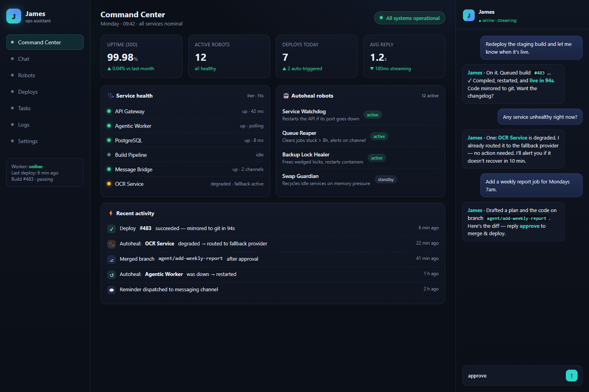
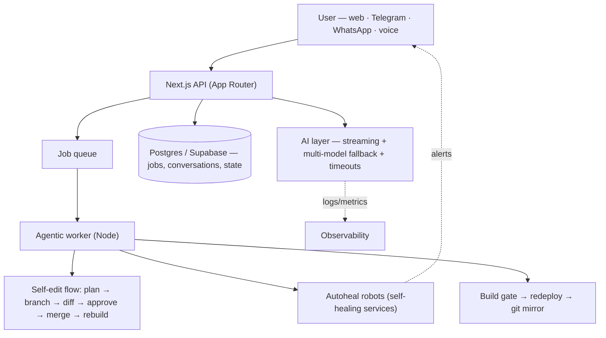

# James — an autonomous AI operations assistant

> A personal AI assistant that doesn't just chat — it **operates, monitors, heals, and even rewrites itself**. Built to run the day-to-day technology operations of a mid-sized company, driven entirely by natural language.

<p align="center">
  
  
  
  
  
</p>

<p align="center">
  
  <br><sub><i>The command center — UI mockup with fictitious data</i></sub>
</p>

---

## What is James?

James is an **AI assistant + autonomous operations platform** I built as a personal project to take over repetitive technical operations at the company I work for. It started as a chat assistant and grew into a system that can:

- Understand requests in plain language (web chat, Telegram, WhatsApp, or voice)
- Run multi-step tasks on its own through an agentic worker
- **Monitor and self-heal** the services it depends on
- **Modify its own source code** from a natural-language request — safely, with human approval and automatic rollback
- Deploy itself and mirror its code to version control automatically

The guiding idea: an assistant should be measured by *what it gets done*, not by how well it talks.

---

## Highlights (the interesting engineering)

### 🧠 A self-editing agent
The feature I'm proudest of. You describe a change in plain language and James:

1. Drafts a **plan** and waits for a "go ahead" (human gate #1)
2. Spins up an **isolated git branch** and makes the change with a headless coding agent
3. Shows you the **diff** and waits for approval (human gate #2)
4. On approval, **merges, rebuilds, and redeploys** — and if the build fails, it **reverts automatically** and preserves the attempt on its branch for review

So the system can evolve itself without ever leaving a broken build in production.

```ts
// Self-editing flow: the assistant changes its own code, safely.
// Two human gates + automatic rollback mean production never sees a broken build.
async function applyChange(task: ChangeRequest) {
  const base = currentBranch();
  const branch = `agent/${task.id}`;
  git.checkout("-B", branch, base);        // isolated branch

  await codingAgent.run(task.prompt);      // headless agent makes the edit
  const diff = git.diff(`${base}...${branch}`);
  await requestApproval(diff);             // human gate #2 (the plan was gate #1)

  git.checkout(base);
  git.merge("--no-ff", branch);
  if (!build().ok) {                        // build must pass…
    git.reset("--hard", base);             // …or we revert, keeping the branch
    return fail("build failed — reverted, change preserved on branch");
  }
  redeploy();
}
```

### 🔁 A resilient multi-model AI layer
The brain is Claude, but a single-provider dependency is a single point of failure. The AI layer:

- Streams responses for snappy UX
- Falls back across **multiple model providers** in order of quality when one is unavailable
- Uses **explicit timeouts** so a hung request can never freeze the chat
- Emits **structured fallback logs** so every degradation is observable and measurable

```ts
// Streaming chat with graceful multi-provider fallback.
// A hung provider can never freeze the UI — every call is bounded by a timeout.
async function* streamReply(messages: Message[]): AsyncGenerator<string> {
  const providers = [primary, secondary, tertiary]; // ordered by quality
  for (const [i, provider] of providers.entries()) {
    try {
      yield* withTimeout(provider.stream(messages), TIMEOUT_MS);
      return;                               // first provider that answers wins
    } catch (err) {
      log.warn(`[fallback] ${provider.name} failed → next`, { err: String(err) });
      if (i === providers.length - 1) throw err; // all providers exhausted
    }
  }
}
```

### 🩺 Declarative self-healing ("autoheal robots")
Infrastructure guardians defined as small, declarative units. Each robot states what it watches, how it heals, and why it's safe to run. They act **only on a confirmed real failure** (never on a hiccup), are idempotent, and report what they fixed. Examples of the pattern:

- Watch a service port and bring it back up if it dies
- Detect a stuck job queue and requeue / fail it with backoff
- Clear a lock that wedged a backup and restart the affected containers

```ts
// Autoheal robots are declarative: what they watch, how they heal, why it's safe.
// They act only on a *confirmed* failure, are idempotent, and report what they did.
const serviceWatchdog: Robot = {
  id: "service-watchdog",
  guards: "Checks the API port every 15s; brings it back up if it's down.",
  safe: true,                 // idempotent — never acts on a transient blip
  async heal() {
    if (await isHealthy(API_PORT)) return "ok: service is up";
    await restartService();
    return "healed: service was down, restarted";
  },
};
```

### 💬 One assistant, many channels
A single conversational core reachable from a web **command center**, **Telegram**, **WhatsApp**, and **voice** — with approvals, reminders, and task dispatch flowing through whichever channel you're in.

### 🚀 Self-deploying
A build gate + watcher pipeline rebuilds the app on demand, restarts cleanly, and **mirrors the code to a private git remote on every deploy** — with secrets kept strictly out of version control.

---

## Architecture (high level)



> Internal hostnames, IP ranges, provider keys, and company-specific business logic are intentionally **not** part of this repository.

---

## Tech stack

| Layer | Choice |
|---|---|
| Framework | Next.js (App Router) + TypeScript |
| Data | PostgreSQL via Supabase (queue, conversations, state) |
| AI | Claude (primary) with multi-provider fallback, streaming, prompt caching |
| Worker | Node.js long-running agentic worker |
| Messaging | Telegram & WhatsApp integrations |
| Delivery | On-demand build + redeploy pipeline, automatic git mirroring |

---

## A note on scope & privacy

James runs real operations for a real company, so this public repository is a **curated showcase**, not the operational codebase. It presents the architecture and the engineering ideas — **no credentials, no internal addresses, no proprietary business logic**. Code snippets shown here are simplified and sanitized for illustration.

## About

I'm a technology professional who likes building systems that remove toil. James is where I explore agentic AI, resilient system design, and self-operating software. Happy to walk through any part of it.

<sub>· All screens shown are UI mockups with fictitious data. ·</sub>
